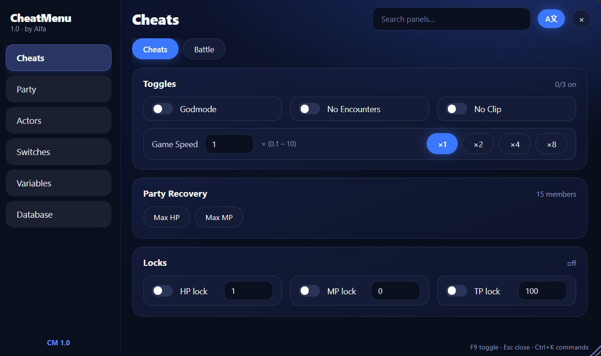

# RPGM_MV-MZ_CheatMenu
A Cheat Menu for RPG Maker MV and MZ version.
# CheatMenu

# Preview

## Install using .bat

1. Put these two files in the game folder (same folder as `Game.exe`):
   - `InstallCheatMenu.bat`
   - `CheatMenu.js`
2. Run `InstallCheatMenu.bat`
3. Launch the game and press **F9**

## Manual Install if you don't trust the .bat (Backup Plugins.js manually is recommended)
1. Type `{"name":"CheatMenu","status":true,"description":"","parameters":{"ToggleKey":"F9"}}` into the Plugins.js line of codes in `www/js/plugins.js` or `js/plugins.js`
2. Copy the `CheatMenu.js` and paste it into `www/js/plugins` or `js/plugins` folder
3. Launch the game and press **F9**

The bat moves `CheatMenu.js` into the plugins folder and adds it to `plugins.js` for you.
Running it twice is fine, it won't add it again. Your original `plugins.js` is saved as `plugins.js.bak`.

## What's in it

- **Cheats tab:** godmode, no encounters, no clip, game speed
- **Party recovery:** Max HP and Max MP for the whole party (separate buttons, one-time refill, not godmode)
- **Locks:** keep HP, MP or TP at a number you pick so it doesn't change, even in battle. Lock the whole party on the Cheats tab, or one character on the Actors tab. A lock beats godmode. HP lock is at least 1.
- **Battle view:** Cheats tab, switch to **Battle**. Force victory / defeat / escape, and edit the HP and MP of every ally and enemy. Allies also have lock boxes.
- **EXP:** give EXP to the whole party, or edit one character's EXP on the Actors tab
- **Skills:** Actors tab, switch to **Skills** to see every skill with icon + name and press Learn / Forget
- **Items, weapons, armors, switches, variables, database:** browse and edit

## Search

Items, weapons, armors, skills, switches and variables have three boxes: **ID**, **Name** and **Amount**. You can use them together.

- **ID:** `5`, `10-20`, or `1,4,9`
- **Name:** any part of the name
- **Amount:** `5`, `10-20`, `>5`, `>=5`, `<5`, `<=5`
  (for switches and skills this box is **State**: `on` / `off`, on = learned for skills)

## Translation

Automatically translates the names of items, weapons, armors, skills, switches, and variables into the target language of your choice.

## Credit
- **Created by:** [Alfa](https://github.com/MuhAlfa)

**Redistribution:** Re-uploading, sharing, or redistributing this plugin package without explicit credit or claiming it as your own work is prohibited.

## Uninstall

Run `RemoveCheatMenu.bat` from the game folder (next to `Game.exe`). It deletes `CheatMenu.js` and removes the entry from `plugins.js`. Other plugins are left alone.
